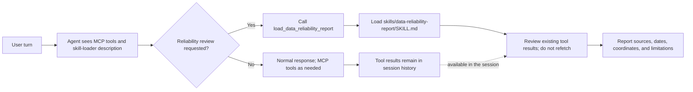
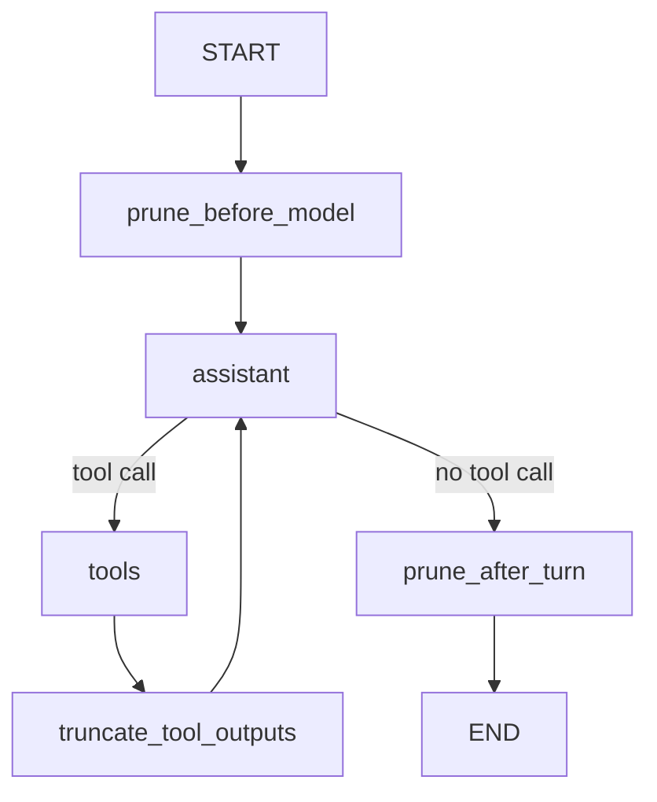

# EVE Earth Observation Agent

This repository contains an end-to-end Python Earth Observation agent: a
FastAPI chat API and LangGraph agent use an MCP server backed by NASA EONET and
Open-Meteo geocoding and historical weather. It is part of a Pi School AI
Research Engineer interview assignment.

## MCP server

[`eve_agent/mcp_server.py`](eve_agent/mcp_server.py) exposes four MCP tools over
Streamable HTTP at `http://127.0.0.1:8001/mcp`:

- `resolve_location` resolves a city and optional country to geocoding
  candidates. Exact duplicate names within the same administrative area are
  narrowed to the most populous result; otherwise, the agent asks which place
  you mean instead of choosing coordinates.
- `search_wildfire_events` retrieves open EONET wildfire-category events
  inside a bounding box. The box arguments are minimum longitude, maximum
  latitude, maximum longitude, and minimum latitude. Optional start and end
  dates must be supplied together; `limit` defaults to 20.
- `search_wildfires_near_location` resolves a city and searches within an
  explicit radius in kilometers (greater than 0 and at most 500). Ambiguous
  city names return candidate locations without searching. The radius is
  converted to an EONET bounding box by the application; existing bounding-box
  searches remain available. Radius searches crossing the antimeridian are
  rejected; use a smaller radius or an ordinary bounding-box search there.
- `get_historical_weather` retrieves daily maximum temperature and total
  precipitation for the requested coordinates and dates. For city queries,
  the agent first resolves the city and uses the returned coordinates.

The EONET tool keeps event identifiers, titles, descriptions, source links,
magnitudes, and geometry dates. Point coordinates are included; polygon
coordinates are omitted to keep the tool response compact.

The tools call the API clients in
[`eve_agent/api_clients.py`](eve_agent/api_clients.py). Inputs are validated
before requests are made; upstream failures are returned as MCP tool errors.
Together, the tools let the agent find wildfire events and retrieve weather
for their locations while keeping sources and data limitations visible.

EONET events are catalogued wildfire-category events and may include prescribed
burns, so the category alone does not establish that a fire is uncontrolled.

## Data sources

- [NASA EONET API v3](https://eonet.gsfc.nasa.gov/docs/v3)
- [Open-Meteo Geocoding API](https://open-meteo.com/en/docs/geocoding-api)
- [Open-Meteo Historical Weather API](https://open-meteo.com/en/docs/historical-weather-api)

The endpoints used here do not require an API key for the demonstrated
requests.

## Requirements

- Python 3.11 or newer (tested with Python 3.14.2)
- Network access to the APIs for live requests
- Ollama installed and running
- Dependencies pinned in [`requirements.txt`](requirements.txt)

## Install and run

From the repository root:

```bash
python3 -m venv .venv
source .venv/bin/activate
python -m pip install -r requirements.txt
cp -n .env.example .env
```

The `.env` file sets `API_HOST` and `API_PORT` (defaults `127.0.0.1` and
`8000`), `MCP_SERVER_HOST` and `MCP_SERVER_PORT` (defaults `127.0.0.1` and
`8001`), and `OLLAMA_MODEL` (default `qwen3.5:4b`). The MCP client uses the
server settings to connect at `http://<host>:<port>/mcp`. `TRACE_FILE` selects
the JSONL request trace path and defaults to `logs/agent-traces.jsonl`. `.env`
is ignored by Git; commit only the non-sensitive `.env.example` template.

## Run the API

Pull the configured model if it is not already installed:

```bash
ollama pull qwen3.5:4b
```

Start the MCP server in one terminal from the repository root:

```bash
source .venv/bin/activate
python -m eve_agent.mcp_server
```

Start the HTTP API in another terminal:

```bash
source .venv/bin/activate
python -m eve_agent.api
```

Send a question and a follow-up with the same `session_id`:

```bash
curl -X POST http://127.0.0.1:8000/chat \
  -H 'Content-Type: application/json' \
  -d '{"session_id":"demo-session","message":"What was the weather in Los Angeles from 2024-08-01 to 2024-08-03?"}'

curl -X POST http://127.0.0.1:8000/chat \
  -H 'Content-Type: application/json' \
  -d '{"session_id":"demo-session","message":"What was the precipitation over the same dates?"}'
```

Each successful request returns JSON with `session_id` and `answer`.

## Run the end-to-end demo

With the MCP server and API running in separate terminals as described above,
run the three-turn demo:

```bash
source .venv/bin/activate
python -m scripts.run_demo
```

The demo creates one session and sends three requests: an EONET wildfire
search, an Open-Meteo weather lookup for the second event, and an invalid-date
request that exercises tool-error handling. The API prints its answers and
writes one trace record per request to `TRACE_FILE`.

[`examples/traces/submission-demo.jsonl`](./examples/traces/submission-demo.jsonl)
is a sample live run. Its three records share a session ID and show both tools
and the invalid-date error/recovery.

To demonstrate context pruning over a longer conversation, run:

```bash
python -m scripts.run_demo --long-context
```

This sends eight turns in one session. The trace records each pruning step's
message count before pruning, number removed, and number retained;
[`examples/traces/long-context-demo.jsonl`](./examples/traces/long-context-demo.jsonl)
shows pruning after the sixth user turn while retaining the recent weather
context. Normal API requests write to the ignored `logs/agent-traces.jsonl` by
default, not to these committed examples.

To demonstrate the on-demand data reliability skill, stop the API if it is
already running, then restart it with a trace path under the ignored `logs/`
directory:

```bash
TRACE_FILE=logs/data-reliability-demo.jsonl python -m eve_agent.api
```

Then run the same demo script with:

```bash
python -m scripts.run_demo --reliability
```

The three-turn conversation searches EONET, gets weather for an event, then
asks for an evidence review. The agent sees the skill tool description on
ordinary turns but loads the full
[`SKILL.md`](./skills/data-reliability-report/SKILL.md) only for the review.
[`examples/traces/data-reliability-demo.jsonl`](./examples/traces/data-reliability-demo.jsonl)
is a committed sample; new runs write to `logs/data-reliability-demo.jsonl`
instead.



The agent graph prunes old history before each model call. The assistant
routes tool calls to the MCP-backed tools node, truncates tool output, and runs
again with the result; it stops when the model returns a final answer.
Tool definitions are loaded over Streamable HTTP by
[`eve_agent/mcp_client.py`](eve_agent/mcp_client.py).



Each model call receives the fixed system prompt and retained conversation
messages: user messages, assistant replies, and tool results. The model is
bound to the MCP and skill-loader tool schemas. The full skill instructions
are returned to the conversation only when the loader tool is called.

The API builds one agent graph at startup. Send the same `session_id` for
follow-up questions in that process; use a different ID for a separate
conversation. The agent retains the latest six user turns (including their
assistant and tool messages) and truncates each tool result to at most 8,000
characters before passing it back to the model. Older messages are removed;
facts available only in those discarded turns may no longer be available to
answer follow-up questions.

Conversation checkpoints use LangGraph's in-memory `MemorySaver`. They are
available only to that agent instance and are lost when the process exits.
A PostgreSQL-backed LangGraph checkpointer is one option for persistent,
multi-process deployments.

## Traces and tool errors

Each `/chat` request appends one JSON record to the file configured by
`TRACE_FILE`. The trace includes the session and trace IDs, input, graph steps,
tool names and arguments, durations, tool results or errors, and final answer.
Rejected requests also produce a trace with the request ID, validation failure,
and session ID when available. Validation error details can include submitted
values, including rejected message text, so treat traces as potentially
containing sensitive input.
Tool result text in traces is capped at 8,000 characters. Tool exceptions are
returned to the graph as tool errors so the agent can explain the failure;
the error is recorded in the request trace. The default `logs/` directory is
Git-ignored. Traces contain conversation input and tool data, so keep them
local unless you have checked their contents before sharing.

## Run tests

From the repository root, with the requirements installed:

```bash
python3 -m unittest discover -s tests -v
```

Tests use mocked API responses and a scripted model, so they do not require
network access or a running Ollama instance.

## Scope and next steps

The application has one agent, four MCP tools for wildfire search, location
resolution, and historical weather, and process-local in-memory conversation
state. The on-demand data reliability Agent Skill is implemented; the optional
A2A bonus is not. The API has no authentication or rate limiting. For a
deployed service, the next steps would be a persistent database-backed
checkpointer, API access controls, and operational monitoring.
